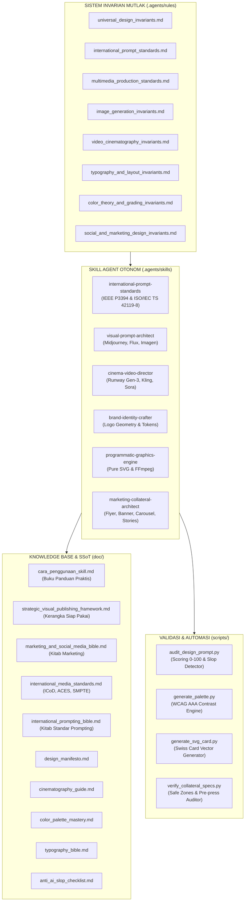

# Desain-Grafis: Autonomous Creative & Multimedia Design System
> **Arsitektur Produksi Multimedia, Video, & Materi Pemasaran Berstandar Internasional**  
> *Purpose-Driven Visuals, Cross-Platform Ready, Hollywood Cinematography, Swiss Modular Grids, and Zero AI Slop.*

---

## 1. PENDAHULUAN & FILOSOFI

**`desain-grafis`** adalah ekosistem rekayasa desain visual, identitas merek, materi pemasaran, dan sinematografi berbasis kolaborasi manusia dan agen kecerdasan buatan (*AI Agents*). Diciptakan sebagai antitesis terhadap fenomena degradasi estetika dan visual generik AI (*AI Visual Slop*), repositori ini meletakkan fondasi matematis, fisika optik, dan filosofi kanonikal yang bersumber dari standar industri visual tertinggi di dunia:

- **Dieter Rams (*10 Principles for Good Design*):** *"Weniger, aber besser"* (Kurang, tapi lebih baik). Desain yang baik adalah desain yang inovatif, berguna, estetis, jujur, tidak mencolok, tahan lama, tuntas hingga detail terkecil, ramah lingkungan, dan sesedikit mungkin menggunakan ornamen tanpa fungsi.
- **Josef Müller-Brockmann (*Grid Systems in Graphic Design*):** Kedisiplinan tata letak arsitektural berbasis kisi modular Swiss kelipatan 8-point (*8pt grid system*).
- **Robert Bringhurst (*The Elements of Typographic Style*):** Skala modular geometris tipografi, ritme optik vertikal, serta kontrol panjang baris ideal 45–75 karakter per baris (*Characters Per Line / CPL*).
- **Johannes Itten & Josef Albers (*Bauhaus Color Theory*):** 7 Kontrak kontras warna, pembagian proporsi visual 60-30-10, dan pemenuhan aksesibilitas rasio kontras WCAG 2.2 AAA ($\ge 7.0:1$).
- **American Society of Cinematographers (ASC):** Taksonomi gramatika bidikan (ELS s/d ECU), vektor pergerakan kamera fisik di atas rel/jib, sudut rana fisik 180° (*180-degree shutter angle rule*), dan kecepatan standar sinema 24fps.
- **ISO 216 & ISO 12647-2 (FOGRA39):** Standar internasional ukuran kertas presisi (DIN A4/A5/A6), bleed pemotongan $+3\text{mm}$, margin aman $\ge 5\text{mm}$, densitas tinta offset TAC $\le 300\%$, dan resolusi cetak $300\text{ DPI}$.
- **IAB Tech Lab (LEAN Framework) & Meta/WhatsApp Safe Zones:** Standar display banner web bebas latensi serta pemetaan zona bahaya antarmuka 9:16 untuk Stories dan WhatsApp Status.

---

## 2. FOKUS UTAMA SISTEM: 10 DIMENSI VISUAL & VIDEO SIAP PAKAI

Seluruh skill dan aturan dalam repositori ini difokuskan untuk menghasilkan **gambar dan video siap pakai (*production-ready*) untuk dipublikasikan di platform mana pun**, yang secara deterministik memuat **10 Dimensi Strategis**:

```
┌────────────────────────────────────────────────────────────────────────┐
│ 10 DIMENSI STRATEGIS KONTEN VISUAL & VIDEO BERDAMPAK TINGGI            │
├────────────────────────────────────────────────────────────────────────┤
│ 1. CORE MESSAGE (Pesan Kunci)       ➔ Proposisi nilai tunggal & lugas  │
│ 2. BRAND SIGNATURE (Ciri Khas)      ➔ Karakter visual pembeda & unik   │
│ 3. BRAND IDENTITY (Branding)        ➔ Logo, warna token, & tipografi   │
│ 4. IRRESISTIBLE OFFER (Penawaran)   ➔ Nilai tambah, diskon, garansi    │
│ 5. PAIN-TO-SOLUTION (Solusi Masalah)➔ Membedah masalah & hadirkan obat │
│ 6. THEMATIC UNIVERSE (Tema Unik)    ➔ Nuansa estetika berkarakter      │
│ 7. CONTEXTUAL MOMENT (Momen Tepat)  ➔ Peluncuran, festive, flash sale  │
│ 8. MONETIZATION (Monetisasi Cepat)  ➔ QR code, voucher, keyword DM     │
│ 9. PERSUASION DYNAMICS (Persuasi)   ➔ Hook 3 detik, AIDA, dwell time   │
│ 10. OMNICHANNEL READY (Siap Pakai)  ➔ Resolusi & safe zone terstandar  │
└────────────────────────────────────────────────────────────────────────┘
```

1. **Core Message (Pesan Kunci):** Tidak ada visual yang hampa makna. Setiap karya membawa satu pesan sentral yang dapat dicerna dalam 3 detik pertama.
2. **Brand Signature (Ciri Khas Unik):** Gaya visual berkarakter (pencahayaan khas, emulasi film kimia nyata, sudut lensa konsisten) yang membedakan brand dari kompetitor generik.
3. **Brand Identity (Branding Terkalibrasi):** Penempatan logo pada zona aman $1X$, kepatuhan token warna terkalibrasi (HEX, sRGB, CMYK, Pantone), dan hierarki font Bringhurst.
4. **Irresistible Offer (Penawaran Bernilai):** Elemen penawaran konkret (diskon peluncuran 25%, bonus edisi terbatas 50 botol bernomor seri, jaminan garansi kepuasan).
5. **Pain-to-Solution (Menjawab Masalah Spesifik):** Mengangkat titik sakit konsumen (*pain point*) dan menampilkan produk/layanan sebagai jawaban definitif (*relief state*).
6. **Thematic Universe (Tema Visual Kohesif):** Menegaskan genre visual: *Quiet Luxury*, *Swiss Brutalist*, *Nordic Daylight*, *Cyberpunk Noir*, atau *Artisanal Heritage*.
7. **Contextual Moment (Momen Tepat):** Terikat pada momentum kontekstual: Hari Peluncuran (*Launch Day*), Momen Hari Raya (*Festive Seasons*), Flash Sale 24 Jam, atau Milestone Perusahaan.
8. **Monetization Triggers (Pemicu Konversi Komersial):** Elemen pemicu transaksi: QR Code pembayaran instan, kata kunci DM ("Ketik 'BELI'"), tombol swipe-up, atau nomor kontak concierge.
9. **Persuasion Dynamics (Psikologi Perhatian):** Mengaplikasikan prinsip henti scroll (*scroll-stopping*), kurva AIDA (*Attention, Interest, Desire, Action*), dan *The Rule of Six* Walter Murch pada video.
10. **Cross-Platform Omnichannel Ready (Siap Pakai Lintas Platform):** Aset diekspor dengan rasio dan zona aman yang langsung kompatibel dengan format platform target tanpa perlu penyesuaian manual.

---

## 3. STANDARD OPERATING PROCEDURE (SOP): 6 LANGKAH PRODUKSI MATERI SIAP PAKAI

Untuk memastikan setiap karya siap terbit dan langsung menghasilkan konversi di platform target, ikuti **SOP 6-Langkah** kanonikal ini:

```
[LANGKAH 1: DEFINISI STRATEGIS & KEBUTUHAN BISNIS]
Tentukan: Pesan Kunci + Masalah Target + Penawaran + Tema + Momen Kampanye.
         │
         ▼
[LANGKAH 2: PERUMUSAN IDENTITAS & CIRI KHAS VISUAL]
Panggil @brand ➔ Rumuskan Arketipe Merek, Geometri Logo, Token Warna 60-30-10, & Font.
         │
         ▼
[LANGKAH 3: ARSITEKTUR PROMPT PERSUASIF & AUDIT MUTU]
Panggil @prompt ➔ Susun Master Prompt standar IEEE P3394 / ISO dan uji skor (Wajib >= 85).
         │
         ▼
[LANGKAH 4: EKSEKUSI PRODUKSI VISUAL & KINEMATIKA]
Panggil @image ➔ Hasilkan foto komersial / potret fotorealistik (Midjourney v6.1 / FLUX.1).
Panggil @video ➔ Sutradarai storyboard & shot list sinematik 24fps (Runway Gen-3 / Kling 1.5).
         │
         ▼
[LANGKAH 5: PACKAGING COLLATERAL & DISTRIBUSI MULTI-SALURAN]
Panggil @marketing ➔ Tata Flayer A5 (+3mm bleed), Carousel 4:5 (8 slide), Stories 9:16.
Panggil @programmatic ➔ Render banner OpenGraph SVG 1200x630 & grading FFmpeg 24fps.
         │
         ▼
[LANGKAH 6: QUALITY GATE & PRE-FLIGHT VERIFICATION]
Jalankan di terminal:
  - python scripts/audit_design_prompt.py    ➔ Skor Mutu Prompt >= 85/100
  - python scripts/generate_palette.py        ➔ Rasio Kontras >= 7.0:1 (WCAG AAA)
  - python scripts/verify_collateral_specs.py ➔ Lulus Bleed Cetak & Safe Zone UI
Aset 100% Siap Diterbitkan (*Production-Ready*).
```

---

## 4. ARSITEKTUR SISTEM (6+1 ENGINE MULTIMEDIA)



---

## 5. PANDUAN STRUKTUR DIREKTORI REPOSITORI

```
desain-grafis/
├── .agents/
│   ├── rules/                                       # 8 Invarian Mutlak Sistem Desain
│   │   ├── universal_design_invariants.md           # 12 Hukum Emas Desain & Anti-Slop
│   │   ├── international_prompt_standards.md        # Standar IEEE P3394, ISO, & Oppenlaender
│   │   ├── multimedia_production_standards.md       # Standar ICoD, ACES, SMPTE, & Ansel Adams
│   │   ├── image_generation_invariants.md           # Rumus 7 Segmen Prompt & Optik Lensa
│   │   ├── video_cinematography_invariants.md       # Gramatika Bidikan & Vektor Kamera
│   │   ├── typography_and_layout_invariants.md      # Grid Swiss & Tipografi Bringhurst
│   │   ├── color_theory_and_grading_invariants.md # Teori Warna 60-30-10 & Film Stock
│   │   └── social_and_marketing_design_invariants.md# Invarian Flayer, Banner, Carousel, & Stories
│   └── skills/                                      # 6 Spesialis Agen Otonom
│       ├── international-prompt-standards/          # Master Arsitek Prompt Internasional
│       │   ├── SKILL.md                             # Kontrak & Instruksi Kerja Skill
│       │   ├── references/                          # Bibliografi & Otoritas Standar
│       │   │   └── academic_and_industry_citations.md
│       │   └── templates/                           # Template Compiler Universal
│       │       └── universal_prompt_compiler.md
│       ├── visual-prompt-architect/                 # DoP Gambar AI (Midjourney & Flux)
│       │   ├── SKILL.md                             # Kontrak & Rumus 7 Segmen Visual
│       │   ├── references/                          # Glosarium Lensa & Sensor Kamera
│       │   │   └── camera_lenses_and_sensors.md
│       │   └── templates/                           # Template Master Visual Siap Pakai
│       │       ├── commercial_product_ad.md
│       │       ├── cinematic_portrait.md
│       │       └── architectural_visualization.md
│       ├── cinema-video-director/                   # Sutradara Film AI (Runway & Kling)
│       │   ├── SKILL.md                             # Kontrak Kontinuitas & Directorial
│       │   ├── references/                          # Glosarium Vektor Kamera ASC
│       │   │   └── camera_movement_glossary.md
│       │   └── templates/                           # Format Naskah Shot List Multi-Shot
│       │       └── short_film_shotlist.md
│       ├── brand-identity-crafter/                  # Perancang Identitas Merek & Desain Sistem
│       │   ├── SKILL.md                             # Kontrak Perancangan Brand & Logo
│       │   ├── references/                          # Anatomi & Klasifikasi Logo Dunia
│       │   │   └── logo_anatomy_and_types.md
│       │   └── templates/                           # Master Manual Pedoman Merek
│       │       └── brand_identity_guideline.md
│       ├── programmatic-graphics-engine/            # Generator SVG Murni & Pipeline FFmpeg
│       │   ├── SKILL.md                             # Kontrak Desain Berbasis Kode
│       │   ├── references/                          # Standar Vektor SVG Mandiri
│       │   │   └── svg_specifications_and_standards.md
│       │   ├── templates/                           # Template Kartu Media Sosial Vektor
│       │   │   └── swiss_vector_card_template.md
│       │   └── scripts/                             # Skrip Generator Grafis Vektor
│       │       ├── generate_svg_card.py
│       │       └── generate_architecture_banner.py
│       └── marketing-collateral-architect/          # Arsitek Materi Pemasaran & Media Sosial
│           ├── SKILL.md                             # Kontrak Desain Flayer, Banner, Carousel, Stories
│           ├── references/                          # Pustaka Standar Dimensi & Safe Zones
│           │   └── international_marketing_specs.md
│           └── templates/                           # Templat Produksi Siap Pakai
│               ├── flyer_print_and_digital_spec.md
│               ├── carousel_narrative_deck_spec.md
│               ├── social_stories_status_spec.md
│               └── iab_display_banners_spec.md
├── doc/                                             # Master SSoT & Buku Panduan Pengetahuan
│   ├── cara_penggunaan_skill.md                     # Buku Panduan Lengkap Interaktif Cara Pakai Skill
│   ├── strategic_visual_publishing_framework.md     # Kerangka Kerja Produksi Gambar & Video Berdampak
│   ├── marketing_and_social_media_bible.md          # Kitab Standar Desain Pemasaran Dunia
│   ├── international_media_standards.md             # Standar Dunia ICoD, ACES, SMPTE, & Ansel Adams
│   ├── international_prompting_bible.md             # Kitab Standar Prompting Internasional
│   ├── design_manifesto.md                          # Manifesto Dieter Rams & Bauhaus
│   ├── cinematography_guide.md                      # Panduan Pencahayaan & Optik Sinema
│   ├── color_palette_mastery.md                     # Master Palet Warna & Kontras WCAG AAA
│   ├── typography_bible.md                          # Kitab Tipografi & Skala Modular
│   └── anti_ai_slop_checklist.md                    # Lembar Audit 25 Poin Kualitas Visual
├── prompts/                                         # Koleksi Master Prompt Terkurasi
│   ├── branding/                                    # Prompts Mockup & Logo Mewah
│   │   └── luxury_monogram_identity.md
│   ├── commercial_ads/                              # Prompts Iklan Komersial Produk
│   │   └── minimalist_coffee_campaign.md
│   ├── cinematic_portraits/                         # Prompts Potret Karakter Sinematik
│   │   └── master_artisan_at_work.md
│   ├── landscape_architecture/                      # Prompts Arsitektur & Spasial
│   │   └── modern_concrete_pavilion.md
│   └── video_sequences/                             # Prompts Klip Video Multi-Shot
│       └── cyberpunk_rain_sequence.md
├── templates/                                       # Template Standar Repositori Siap Pakai
│   ├── storyboard_template.md                       # Lembar Storyboard Multi-Shot
│   ├── moodboard_specification.md                   # Format 5 Kuadran Resonansi Visual
│   ├── brand_guidelines_template.md                 # Manual Pedoman Merek Korporat
│   ├── kala_coffee_marketing_launch_spec.md         # Spesifikasi Kampanye Flayer & Carousel KALA
│   ├── architecture_launch_swiss_card.svg           # Banner OpenGraph Arsitektur Modernist 1200x630
│   └── sample_swiss_card.svg                        # Sampel Vektor SVG Swiss Card 1200x630
├── scripts/                                         # Perangkat Lunak Audit & Otomasi Terminal
│   ├── audit_design_prompt.py                       # Auditor Kualitas Prompt (Skor 0-100 Poin)
│   ├── generate_palette.py                          # Kalkulator Kontras & Luminansi WCAG 2.2 AAA
│   └── verify_collateral_specs.py                   # Validator Safe Zones, Bleeds, & IAB Banners
├── AGENTS.md                                        # Kontrak Tata Kelola Agen Otonom
├── GEMINI.md                                        # Instruksi Eksekusi Root Workspace
├── llms.txt                                         # AI Fast Task Router & Peta Invarian
└── README.md                                        # Dokumentasi Utama Repositori
```

---

## 6. PANDUAN LENGKAP CARA PENGGUNAAN SKILL (COMPREHENSIVE PLAYBOOK)

Repositori ini ditenagai oleh **6 Skill Spesialis Otonom** yang saling melengkapi untuk merancang materi visual dan video siap pakai:

---

### 6.1. Skill 1: `international-prompt-standards` (Tag: `@prompt`)

| Atribut | Keterangan |
| :--- | :--- |
| **Pemicu Utama** | `@prompt`, `@prompt-standard`, `@standard` |
| **Fokus Fungsi** | Audit Mutu Prompt, Eliminasi Slop, Rekayasa Pesan Persuasif, & Kompilasi IEEE/ISO |
| **Otoritas Acuan** | IEEE P3394, ISO/IEC TS 42119-8, Jonas Oppenlaender ACM Taxonomy, Anthropic XML, OpenAI Guide |
| **Berkas Kontrak** | [`.agents/skills/international-prompt-standards/SKILL.md`](.agents/skills/international-prompt-standards/SKILL.md) |

#### A. Kapan Menggunakannya?
1. Saat Anda memiliki ide prompt mentah atau naskah promosi dan ingin mengubahnya menjadi format berstandar internasional yang deterministik, persuasif, dan bebas slop.
2. Saat Anda ingin mengaudit apakah prompt membawa pesan, optik fisik nyata, dan bebas dari kata-kata basi AI (*buzzwords* seperti "photorealistic", "8k", "ultra realistic").
3. Saat Anda ingin mengonversi satu konsep kampanye ke format spesifik Midjourney v6.1, FLUX.1, Runway Gen-3, atau Kling 1.5.

#### B. Cara Memanggil:
```text
@prompt tolong audit dan sempurnakan ide saya ini menjadi prompt foto komersial berbobot pesan solusi masalah & penawaran:
"foto botol skincare serum wajah untuk wanita kulit sensitif, sangat realistis 8k, diskon peluncuran"
```

#### C. Output yang Dihasilkan:
Agen mengeliminasi kata-kata basi, menginjeksi lensa macro 100mm $f/4$, pencahayaan softbox studio terarah, mikrotetesan air, dan parameter teknis `--style raw --v 6.1` dengan skor audit $\ge 85/100$.

---

### 6.2. Skill 2: `visual-prompt-architect` (Tag: `@image` / `@visual`)

| Atribut | Keterangan |
| :--- | :--- |
| **Pemicu Utama** | `@image`, `@visual`, `@prompt-image` |
| **Fokus Fungsi** | DoP Generasi Gambar Siap Pakai, Menonjolkan Ciri Khas Produk, & Tekstur Otentik |
| **Target Engine** | Midjourney v6.1, FLUX.1 (Dev & Schnell), Imagen 3, Stable Diffusion XL |
| **Berkas Kontrak** | [`.agents/skills/visual-prompt-architect/SKILL.md`](.agents/skills/visual-prompt-architect/SKILL.md) |

#### A. Kapan Menggunakannya?
1. Saat Anda ingin memproduksi foto iklan komersial produk mewah (jam tangan, parfum, kuliner, otomotif).
2. Saat Anda ingin membuat potret manusia fotorealistik dengan mikropori kulit asli (*subsurface scattering*) yang mengekspresikan empati masalah (*problem state*) atau kelegaan (*solution state*).
3. Saat Anda membutuhkan visual arsitektur interior atau lanskap spasial yang memancarkan tema estetika tertentu.

#### B. Cara Memanggil:
```text
@image buatkan prompt foto komersial botol kaca amber artisanal coffee KALA di atas batu basalt basah dengan percikan air dingin untuk Midjourney v6.1
```

#### C. Formula 7 Segmen Fisik:
$$\text{Prompt} = \text{Subject} + \text{Environment} + \text{Camera Optics} + \text{Lighting} + \text{Color/Film} + \text{Texture} + \text{Parameters}$$

---

### 6.3. Skill 3: `cinema-video-director` (Tag: `@video` / `@cinema`)

| Atribut | Keterangan |
| :--- | :--- |
| **Pemicu Utama** | `@video`, `@cinema`, `@storyboard` |
| **Fokus Fungsi** | Penyutradaraan Video Iklan 24fps, Hook 3 Detik, Kontinuitas Narasi, & Pemicu Konversi |
| **Target Engine** | Runway Gen-3 Alpha, Kling 1.5 Pro, OpenAI Sora, Luma Dream Machine |
| **Berkas Kontrak** | [`.agents/skills/cinema-video-director/SKILL.md`](.agents/skills/cinema-video-director/SKILL.md) |

#### A. Kapan Menggunakannya?
1. Saat Anda ingin memproduksi klip video promosi multi-adegan (15s / 30s / 60s) dengan hook henti scroll pada adegan pertama.
2. Saat Anda membutuhkan naskah *Storyboard* dan *Shot List* profesional terkalibrasi pergerakan kamera nyata (Dolly In, Truck, Pan, Crane) tanpa *morphing* atau *camera drifting*.
3. Saat Anda ingin menyusun prompt video spesifik yang memisahkan instruksi kamera (`[Camera]: ...`) dan aksi fisik subjek (`[Scene]: ...`).

#### B. Cara Memanggil:
```text
@video buatkan storyboard dan shot list 3 adegan berurutan untuk video iklan kopi cold brew artisanal, durasi 15 detik, gaya sinematik sinema film 24fps
```

---

### 6.4. Skill 4: `brand-identity-crafter` (Tag: `@brand` / `@identity`)

| Atribut | Keterangan |
| :--- | :--- |
| **Pemicu Utama** | `@brand`, `@identity`, `@logo` |
| **Fokus Fungsi** | Ciri Khas Merek Abadi, Konstruksi Geometris Logo Paul Rand, & Sistem Token Warna |
| **Standar Acuan** | Paul Rand (7 Logo Tests), Michael Bierut (Pentagram), Dieter Rams, ISO 12647 Print Standards |
| **Berkas Kontrak** | [`.agents/skills/brand-identity-crafter/SKILL.md`](.agents/skills/brand-identity-crafter/SKILL.md) |

#### A. Kapan Menggunakannya?
1. Saat Anda ingin membangun ciri khas identitas merek korporat dari nol (Arketipe Merek, Filosofi, Konstruksi Logo, dan *Tone of Voice*).
2. Saat Anda membutuhkan sistem token warna terkalibrasi resmi (HEX, sRGB digital, CMYK offset percetakan, dan Pantone Matching System / PMS) yang memenuhi rasio kontras WCAG AAA.
3. Saat Anda membutuhkan pedoman hierarki tipografi (*Display, Section, Body, Monospace Data*) dan manual larangan perlakuan logo (*Brand Do's & Don'ts*).

#### B. Cara Memanggil:
```text
@brand buatkan spesifikasi identitas merek lengkap untuk brand kopi artisanal botol amber bernama "KALA COFFEE", mencakup filosofi, konstruksi logo, token warna, dan tipografi
```

---

### 6.5. Skill 5: `programmatic-graphics-engine` (Tag: `@programmatic` / `@svg`)

| Atribut | Keterangan |
| :--- | :--- |
| **Pemicu Utama** | `@programmatic`, `@svg`, `@code-graphics` |
| **Fokus Fungsi** | Desain Berbasis Kode Deterministik, Banner Vektor SVG Murni 100%, & Pipeline FFmpeg 24fps |
| **Teknologi** | Pure SVG (XML), CSS3 Typography, Python Matplotlib/Pillow, FFmpeg Multimedia |
| **Berkas Kontrak** | [`.agents/skills/programmatic-graphics-engine/SKILL.md`](.agents/skills/programmatic-graphics-engine/SKILL.md) |

#### A. Kapan Menggunakannya?
1. Saat Anda membutuhkan banner vektor murni (SVG) yang tajam $100\%$ tanpa pikselasi untuk kartu pratinjau media sosial OpenGraph ($1200\times 630\text{px}$), ikon website, atau poster tipografi Swiss.
2. Saat Anda membutuhkan tata letak tipografi presisi berbasis kode (*code-first design*) yang dapat digenerasikan secara massal via skrip otomatis.
3. Saat Anda membutuhkan automasi pemrosesan video FFmpeg deterministik (konversi ke 24fps sinematik, penerapan file LUT 3D warna kimia, pemotongan video halus).

#### B. Cara Memanggil:
```text
@programmatic buatkan file banner OpenGraph SVG berukuran 1200x630 bertema Swiss Grid Modernist untuk peluncuran arsitektur desain baru
```

---

### 6.6. Skill 6: `marketing-collateral-architect` (Tag: `@marketing` / `@collateral`, `@flyer`, `@carousel`, `@status`)

| Atribut | Keterangan |
| :--- | :--- |
| **Pemicu Utama** | `@marketing`, `@collateral`, `@flyer`, `@carousel`, `@status`, `@stories` |
| **Fokus Fungsi** | Flayer Cetak Presisi (A4/A5), IAB Banners, Carousel 4:5 Naratif, & Stories 9:16 Siap Terbit |
| **Standar Acuan** | ISO 216 (A4/A5/A6), ISO 12647-2 (FOGRA39 CMYK), IAB Tech Lab LEAN, Meta/WhatsApp UI Safe Zones |
| **Berkas Kontrak** | [`.agents/skills/marketing-collateral-architect/SKILL.md`](.agents/skills/marketing-collateral-architect/SKILL.md) |

#### A. Kapan Menggunakannya?
1. Saat Anda ingin merancang **Flayer Promosi Siap Cetak (DIN A4/A5/A6)** lengkap dengan bleed pemotongan $+3\text{mm}$, margin aman $\ge 5\text{mm}$, resolusi 300 DPI, dan tata letak titik pusat optik (*optical center* 55–60%).
2. Saat Anda membutuhkan **Banner Web Display IAB** (Medium Rectangle 300x250, Leaderboard 728x90, Half-Page 300x600, Billboard 970x250) yang mematuhi batas bobot file LEAN ($\le 200\text{KB}$) dan bingkai 1px.
3. Saat Anda merancang **Dek Carousel Multi-Slide 4:5 ($1080\times 1350\text{px}$)** untuk Instagram Feed dan LinkedIn Document PDF dengan busur cerita 7–10 slide (Hook ➔ Context ➔ Meat ➔ Climax ➔ CTA) yang menghentikan laju scroll audiens.
4. Saat Anda merancang poster **Image Status & Stories Layar Penuh 9:16 ($1080\times 1920\text{px}$)** untuk WhatsApp Status, Instagram Stories, dan Facebook Stories dengan kepatuhan zona aman antarmuka (bebas dari bahaya tertutup bilah atas 270px dan bilah pesan bawah 270px/670px).

#### B. Cara Memanggil:
```text
@marketing buatkan spesifikasi flayer cetak A5 dan postingan carousel 8 slide untuk promosi peluncuran kopi artisanal botol kaca amber "KALA COFFEE"
```

---

## 7. MATRIKS REFERENSI LENGKAP SELURUH SKILL (SKILL REFERENCE MATRIX)

Tabel navigasi kanonikal (*Single Source of Truth / SSoT*) yang menghubungkan seluruh berkas panduan, aturan, referensi pustaka, templat kerja, dan skrip automasi untuk ke-6 skill:

| Nama Skill & Tag | Kontrak Skill (`SKILL.md`) | Invarian Aturan (`.agents/rules/`) | Knowledge Base (`doc/`) | Pustaka Referensi Lokal (`references/`) | Templat Produksi Siap Pakai (`templates/`) | Skrip Uji & Automasi (`scripts/`) |
| :--- | :--- | :--- | :--- | :--- | :--- | :--- |
| **`international-prompt-standards`**<br/>`@prompt` | [`SKILL.md`](.agents/skills/international-prompt-standards/SKILL.md) | [`international_prompt_standards.md`](.agents/rules/international_prompt_standards.md) | [`international_prompting_bible.md`](doc/international_prompting_bible.md)<br/>[`strategic_visual_publishing_framework.md`](doc/strategic_visual_publishing_framework.md) | [`academic_and_industry_citations.md`](.agents/skills/international-prompt-standards/references/academic_and_industry_citations.md) | [`universal_prompt_compiler.md`](.agents/skills/international-prompt-standards/templates/universal_prompt_compiler.md) | [`audit_design_prompt.py`](scripts/audit_design_prompt.py) |
| **`visual-prompt-architect`**<br/>`@image` / `@visual` | [`SKILL.md`](.agents/skills/visual-prompt-architect/SKILL.md) | [`image_generation_invariants.md`](.agents/rules/image_generation_invariants.md) | [`anti_ai_slop_checklist.md`](doc/anti_ai_slop_checklist.md) | [`camera_lenses_and_sensors.md`](.agents/skills/visual-prompt-architect/references/camera_lenses_and_sensors.md) | [`commercial_product_ad.md`](.agents/skills/visual-prompt-architect/templates/commercial_product_ad.md)<br/>[`cinematic_portrait.md`](.agents/skills/visual-prompt-architect/templates/cinematic_portrait.md)<br/>[`architectural_visualization.md`](.agents/skills/visual-prompt-architect/templates/architectural_visualization.md) | [`audit_design_prompt.py`](scripts/audit_design_prompt.py) |
| **`cinema-video-director`**<br/>`@video` / `@cinema` | [`SKILL.md`](.agents/skills/cinema-video-director/SKILL.md) | [`video_cinematography_invariants.md`](.agents/rules/video_cinematography_invariants.md) | [`cinematography_guide.md`](doc/cinematography_guide.md) | [`camera_movement_glossary.md`](.agents/skills/cinema-video-director/references/camera_movement_glossary.md) | [`short_film_shotlist.md`](.agents/skills/cinema-video-director/templates/short_film_shotlist.md)<br/>[`storyboard_template.md`](templates/storyboard_template.md) | [`audit_design_prompt.py`](scripts/audit_design_prompt.py) |
| **`brand-identity-crafter`**<br/>`@brand` / `@identity` | [`SKILL.md`](.agents/skills/brand-identity-crafter/SKILL.md) | [`typography_and_layout_invariants.md`](.agents/rules/typography_and_layout_invariants.md) | [`typography_bible.md`](doc/typography_bible.md)<br/>[`color_palette_mastery.md`](doc/color_palette_mastery.md) | [`logo_anatomy_and_types.md`](.agents/skills/brand-identity-crafter/references/logo_anatomy_and_types.md) | [`brand_identity_guideline.md`](.agents/skills/brand-identity-crafter/templates/brand_identity_guideline.md)<br/>[`brand_guidelines_template.md`](templates/brand_guidelines_template.md) | [`generate_palette.py`](scripts/generate_palette.py) |
| **`programmatic-graphics-engine`**<br/>`@programmatic` / `@svg` | [`SKILL.md`](.agents/skills/programmatic-graphics-engine/SKILL.md) | [`typography_and_layout_invariants.md`](.agents/rules/typography_and_layout_invariants.md) | [`typography_bible.md`](doc/typography_bible.md) | [`svg_specifications_and_standards.md`](.agents/skills/programmatic-graphics-engine/references/svg_specifications_and_standards.md) | [`swiss_vector_card_template.md`](.agents/skills/programmatic-graphics-engine/templates/swiss_vector_card_template.md)<br/>[`architecture_launch_swiss_card.svg`](templates/architecture_launch_swiss_card.svg) | [`generate_svg_card.py`](.agents/skills/programmatic-graphics-engine/scripts/generate_svg_card.py)<br/>[`generate_architecture_banner.py`](.agents/skills/programmatic-graphics-engine/scripts/generate_architecture_banner.py) |
| **`marketing-collateral-architect`**<br/>`@marketing` / `@collateral` | [`SKILL.md`](.agents/skills/marketing-collateral-architect/SKILL.md) | [`social_and_marketing_design_invariants.md`](.agents/rules/social_and_marketing_design_invariants.md) | [`marketing_and_social_media_bible.md`](doc/marketing_and_social_media_bible.md)<br/>[`strategic_visual_publishing_framework.md`](doc/strategic_visual_publishing_framework.md) | [`international_marketing_specs.md`](.agents/skills/marketing-collateral-architect/references/international_marketing_specs.md) | [`flyer_print_and_digital_spec.md`](.agents/skills/marketing-collateral-architect/templates/flyer_print_and_digital_spec.md)<br/>[`carousel_narrative_deck_spec.md`](.agents/skills/marketing-collateral-architect/templates/carousel_narrative_deck_spec.md)<br/>[`kala_coffee_marketing_launch_spec.md`](templates/kala_coffee_marketing_launch_spec.md) | [`verify_collateral_specs.py`](scripts/verify_collateral_specs.py) |

---

## 8. PERANGKAT VALIDASI MANDIRI (SELF-SERVICE CLI QUALITY GATES)

Anda dapat menguji kualitas prompt, aksesibilitas warna, zona aman media sosial, dan merender aset grafis secara mandiri melalui terminal:

### 1. Mengaudit Kualitas Prompt (Deteksi Slop & Skor 0–100):
```bash
python scripts/audit_design_prompt.py
```
*Output yang Dihasilkan:* Pemindaian kata terlarang, validasi kepatuhan 6 modifier Oppenlaender, uji optik kamera fisik, dan status kelulusan standar ISO/IEC TS 42119-8 (Standar Lulus: $\ge 85/100$).

### 2. Menguji Rasio Kontras Palet Warna (WCAG 2.2 AAA):
```bash
python scripts/generate_palette.py
```
*Output yang Dihasilkan:* Perhitungan matematis luminansi relatif, pengujian rasio kontras warna teks dan aksen terhadap kanvas latar belakang (Standar Lulus AAA: $\ge 7.0:1$).

### 3. Memverifikasi Spesifikasi Marketing, Bleed, & Safe Zones 9:16:
```bash
python scripts/verify_collateral_specs.py
```
*Output yang Dihasilkan:* Verifikasi ukuran flayer ISO 216 (+3mm bleed), dimensi display IAB, batas padding carousel 4:5, serta simulasi zona bahaya antarmuka status WhatsApp dan Instagram Stories ($1080\times 1920\text{px}$).

### 4. Merender Banner Grafis Vektor Swiss Berbasis Kode:
```bash
python .agents/skills/programmatic-graphics-engine/scripts/generate_architecture_banner.py
```
*Output yang Dihasilkan:* Berkas OpenGraph SVG murni `templates/architecture_launch_swiss_card.svg` berukuran $1200\times 630\text{px}$ dengan modular grid 80px yang tajam tanpa pikselasi.

---

## 9. STANDAR KUALITAS: ZERO AI SLOP GUARANTEE

Setiap hasil karya prompt, video, tata letak, dan grafis yang diproduksi melalui repositori ini digaransi **100% bebas dari cacat umum AI**:
1. **Tekstur Kulit Biologis Asli:** Kulit manusia menampilkan mikropori alami (*subsurface scattering*), garis tawa wajar, dan *catchlight* bola mata koheren; bukan lilin sintetis mengkilap.
2. **Anatomi Tangan Presisi:** Tepat 5 jari dengan artikulasi sendi dan bantalan kuku yang proporsional.
3. **Disiplin Palet & Film Stock:** Bebas dari gradasi ungu-pink neon toksik murahan; menggunakan emulasi film kimia legendaris (Kodak Portra 400, Kodak Vision3 500T, Fuji Eterna) serta rasio distribusi warna 60-30-10.
4. **Tipografi Bersih & Bermakna:** Bebas dari teks alien acak mengambang; setiap teks menggunakan jenis huruf terkalibrasi atau diisolasi secara sengaja.
5. **Kinetika Video Berbobot Gravitasi:** Pergerakan kamera video memiliki inersia fisik dan kecepatan standar sinema 24fps tanpa *drifting*, *floating*, atau *morphing* objek yang tidak wajar.
6. **Presisi Cetak & Zona Aman Layar:** Flayer dilengkapi bleed $+3\text{mm}$ dan resolusi $300\text{ DPI}$, sedangkan aset Stories/Status 9:16 dipastikan bersih dari potongan antarmuka tombol reply atau header sistemik.
