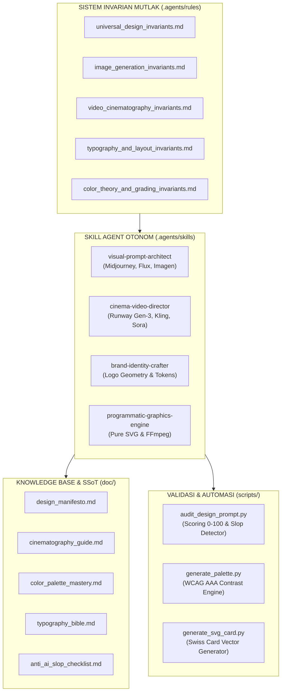

# Desaiin-Grafis: Autonomous Creative & Multimedia Design System
> **Arsitektur Produksi Multimedia & Arahan Seni Berstandar Internasional**  
> *Deterministic Visual Prompting, Hollywood Cinematography, Swiss Modular Grids, and Zero AI Slop.*

---

## 1. PENDAHULUAN & FILOSOFI

**`desaiin-grafis`** adalah ekosistem rekayasa desain visual dan sinematografi berbasis agen otonom dan manusia. Diciptakan untuk memecahkan masalah degradasi kualitas pada generasi visual AI (*AI Visual Slop*), repositori ini meletakkan fondasi matematis dan filosofis yang kokoh bersumber dari standar tertinggi dunia:

- **Dieter Rams (*10 Principles for Good Design*):** *"Weniger, aber besser"* (Kurang, tapi lebih baik). Eliminasi ornamen tanpa fungsi.
- **Josef Müller-Brockmann (*Grid Systems*):** Kedisiplinan tata letak modular grid Swiss 8-point.
- **Robert Bringhurst (*The Elements of Typographic Style*):** Ritme optik, skala modular geometris, dan batas baris optimal 45–75 CPL.
- **Johannes Itten & Josef Albers (*Bauhaus*):** 7 Kontrak warna, aturan distribusi 60-30-10, dan kepatuhan WCAG 2.2 AAA.
- **American Society of Cinematographers (ASC):** Gramatika bidikan (ELS s/d ECU), vektor gerak fisik, sudut rana 180°, dan kontinuitas 24fps.
- **Disney's 12 Principles of Animation:** Kinetika gerak alami, *anticipation*, *follow-through*, dan *easing curves*.

---

## 2. ARSITEKTUR SISTEM (5+1 ENGINE MULTIMEDIA)



---

## 3. PANDUAN STRUKTUR DIREKTORI

```
desaiin-grafis/
├── .agents/
│   ├── rules/                              # 5 Invarian Mutlak Sistem
│   │   ├── universal_design_invariants.md  # 12 Hukum Emas Desain & Anti-Slop
│   │   ├── image_generation_invariants.md  # Rumus 7 Segmen Prompt & Optik Lensa
│   │   ├── video_cinematography_invariants.md# Gramatika Bidikan & Vektor Kamera
│   │   ├── typography_and_layout_invariants.md# Grid Swiss & Tipografi Bringhurst
│   │   └── color_theory_and_grading_invariants.md# Teori Warna 60-30-10 & Film Stock
│   └── skills/                             # 4 Spesialis Agen Otonom
│       ├── visual-prompt-architect/        # DoP Gambar AI (Midjourney & Flux)
│       ├── cinema-video-director/          # Sutradara Film AI (Runway & Kling)
│       ├── brand-identity-crafter/         # Perancang Sistem Identitas Merek
│       └── programmatic-graphics-engine/   # Generator SVG & Pipeline FFmpeg
├── doc/                                    # Master SSoT & Buku Panduan
│   ├── design_manifesto.md                 # Manifesto Dieter Rams & Bauhaus
│   ├── cinematography_guide.md             # Panduan Pencahayaan & Optik Sinema
│   ├── color_palette_mastery.md            # Master Palet & Kontras WCAG AAA
│   ├── typography_bible.md                 # Kitab Tipografi & Skala Modular
│   └── anti_ai_slop_checklist.md           # Lembar Audit 25 Poin Kualitas Visual
├── prompts/                                # Koleksi Master Prompt Terkurasi
│   ├── branding/                           # Prompts Mockup & Logo Mewah
│   ├── commercial_ads/                     # Prompts Iklan Komersial Produk
│   ├── cinematic_portraits/                # Prompts Potret Karakter Sinematik
│   ├── landscape_architecture/             # Prompts Arsitektur & Spasial
│   └── video_sequences/                    # Prompts Klip Video Multi-Shot
├── templates/                              # Template Standar Siap Pakai
│   ├── storyboard_template.md              # Lembar Storyboard Multi-Shot
│   ├── moodboard_specification.md          # Format 5 Kuadran Resonansi Visual
│   └── brand_guidelines_template.md        # Manual Pedoman Merek Korporat
├── scripts/                                # Perangkat Lunak Audit & Otomasi
│   ├── audit_design_prompt.py              # Auditor Kualitas Prompt (0-100 Poin)
│   └── generate_palette.py                 # Kalkulator Kontras & Luminansi WCAG
├── AGENTS.md                               # Kontrak Tata Kelola Agen Otonom
├── GEMINI.md                               # Instruksi Eksekusi Workspace
├── llms.txt                                # AI Fast Task Router & Peta Invarian
└── README.md                               # Dokumentasi Utama Repositori
```

---

## 4. CARA MENGGUNAKAN SISTEM

### A. Menghasilkan Prompt Gambar Berkualitas Dunia:
Ketik perintah dengan menyertakan tag `@image` atau panggil skill `visual-prompt-architect`. Agen akan secara otomatis menerapkan formula 7 segmen (Subjek + Lingkungan + Lensa/Optik Kamera + Skema Pencahayaan + Palet & Film Stock + Tekstur Mikro + Parameter Engine).

### B. Mengarahkan Video Sinematik Multi-Shot:
Ketik perintah dengan menyertakan tag `@video` atau panggil skill `cinema-video-director`. Agen akan menyusun *Shot List*, mendefinisikan vektor gerak fisik kamera (Dolly/Pan/Crane), mengatur rana 180°, dan menjamin kontinuitas adegan berdasarkan *6 Rules of Walter Murch*.

### C. Mengaudit Kualitas Prompt (Deteksi Slop):
Jalankan skrip auditor bawaan di terminal:
```bash
python scripts/audit_design_prompt.py
```
Skrip akan memindai prompt, memberikan skor 0–100, mendeteksi kata-kata terlarang (*buzzwords*), dan memastikan optik kamera serta pencahayaan fisik telah terpenuhi (Standar Lulus: $\ge 85/100$).

### D. Menguji Rasio Kontras Palet Warna (WCAG 2.2 AAA):
Jalankan skrip kalkulator kontras:
```bash
python scripts/generate_palette.py
```
Skrip menghitung luminansi relatif secara matematis dan menguji apakah rasio kontras teks terhadap latar belakang mencapai $\ge 7:1$ (Level AAA).

### E. Menghasilkan Banner SVG Berbasis Kode:
Jalankan generator grafis vektor Swiss:
```bash
python .agents/skills/programmatic-graphics-engine/scripts/generate_svg_card.py
```
Menghasilkan banner OpenGraph `sample_swiss_card.svg` dengan grid arsitektural 80px dan tipografi tajam tanpa pikselasi.

---

## 5. STANDAR KUALITAS: ZERO AI SLOP GUARANTEE

Setiap hasil karya yang diproduksi melalui repositori ini digaransi **100% bebas dari cacat umum AI**:
1. Kulit manusia memiliki mikropori alami (*subsurface scattering*), bukan lilin sintetis mengkilap.
2. Tangan memiliki tepat 5 jari dengan artikulasi sendi dan kuku yang akurat.
3. Bebas dari gradasi ungu-pink neon toksik; menggunakan emulasi film stock legendaris (Kodak Portra, Kodak Vision3, Fuji Eterna).
4. Bebas dari teks alien mengambang; setiap teks ditulis dengan tipografi terkalibrasi atau diisolasi secara sengaja.
5. Kamera video bergerak dengan inersia fisik dan kecepatan sinema 24fps tanpa *drifting* atau *morphing*.
