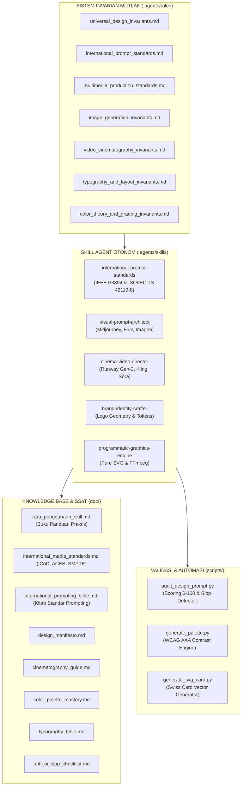

# Desain-Grafis: Autonomous Creative & Multimedia Design System
> **Arsitektur Produksi Multimedia & Arahan Seni Berstandar Internasional**  
> *Deterministic Visual Prompting, Hollywood Cinematography, Swiss Modular Grids, and Zero AI Slop.*

---

## 1. PENDAHULUAN & FILOSOFI

**`desain-grafis`** adalah ekosistem rekayasa desain visual, identitas merek, dan sinematografi berbasis kolaborasi manusia dan agen kecerdasan buatan (*AI Agents*). Diciptakan sebagai antitesis terhadap fenomena degradasi estetika dan cacat visual generatif AI (*AI Visual Slop*), repositori ini meletakkan fondasi matematis, fisika optik, dan filosofi kanonikal yang bersumber dari standar industri visual tertinggi di dunia:

- **Dieter Rams (*10 Principles for Good Design*):** *"Weniger, aber besser"* (Kurang, tapi lebih baik). Desain yang baik adalah desain yang inovatif, berguna, estetis, jujur, tidak mencolok, tahan lama, tuntas hingga detail terkecil, ramah lingkungan, dan sesedikit mungkin menggunakan ornamen tanpa fungsi.
- **Josef Müller-Brockmann (*Grid Systems in Graphic Design*):** Kedisiplinan tata letak arsitektural berbasis kisi modular Swiss kelipatan 8-point (*8pt grid system*).
- **Robert Bringhurst (*The Elements of Typographic Style*):** Skala modular geometris tipografi, ritme optik vertikal, serta kontrol panjang baris ideal 45–75 karakter per baris (*Characters Per Line / CPL*).
- **Johannes Itten & Josef Albers (*Bauhaus Color Theory*):** 7 Kontrak kontras warna, pembagian proporsi visual 60-30-10, dan pemenuhan aksesibilitas rasio kontras WCAG 2.2 AAA ($\ge 7.0:1$).
- **American Society of Cinematographers (ASC):** Taksonomi gramatika bidikan (ELS s/d ECU), vektor pergerakan kamera fisik di atas rel/jib, sudut rana fisik 180° (*180-degree shutter angle rule*), dan kecepatan standar sinema 24fps.
- **Disney's 12 Principles of Animation & Walter Murch (*The Rule of Six*):** Kinetika gerak alami, inersia fisik, antisipasi, *follow-through*, serta hierarki kontinuitas editing film berbasis emosi penonton.

---

## 2. ARSITEKTUR SISTEM (5+1 ENGINE MULTIMEDIA)



---

## 3. PANDUAN STRUKTUR DIREKTORI REPOSITORI

```
desain-grafis/
├── .agents/
│   ├── rules/                                       # 7 Invarian Mutlak Sistem Desain
│   │   ├── universal_design_invariants.md           # 12 Hukum Emas Desain & Anti-Slop
│   │   ├── international_prompt_standards.md        # Standar IEEE P3394, ISO, & Oppenlaender
│   │   ├── multimedia_production_standards.md       # Standar ICoD, ACES, SMPTE, & Ansel Adams
│   │   ├── image_generation_invariants.md           # Rumus 7 Segmen Prompt & Optik Lensa
│   │   ├── video_cinematography_invariants.md       # Gramatika Bidikan & Vektor Kamera
│   │   ├── typography_and_layout_invariants.md      # Grid Swiss & Tipografi Bringhurst
│   │   └── color_theory_and_grading_invariants.md # Teori Warna 60-30-10 & Film Stock
│   └── skills/                                      # 5 Spesialis Agen Otonom
│       ├── international-prompt-standards/          # Master Arsitek Prompt Internasional
│       │   ├── SKILL.md                             # Kontrak & Instruksi Kerja Skill
│       │   ├── references/                          # Bibliografi & Otoritas Standar
│       │   │   └── academic_and_industry_citations.md
│       │   └── templates/                           # Template Compiler Universal
│       │       └── universal_prompt_compiler.md
│       ├── visual-prompt-architect/                 # DoP Gambar AI (Midjourney & Flux)
│       │   ├── SKILL.md                             # Kontrak & Rumus 7 Segmen Visual
│       │   ├── references/                          # Glosarium Lensa & Sensor Kamera
│       │   │   └── camera_lenses_and_sensors.md
│       │   └── templates/                           # Template Master Visual Siap Pakai
│       │       ├── commercial_product_ad.md
│       │       ├── cinematic_portrait.md
│       │       └── architectural_visualization.md
│       ├── cinema-video-director/                   # Sutradara Film AI (Runway & Kling)
│       │   ├── SKILL.md                             # Kontrak Kontinuitas & Directorial
│       │   ├── references/                          # Glosarium Vektor Kamera ASC
│       │   │   └── camera_movement_glossary.md
│       │   └── templates/                           # Format Naskah Shot List Multi-Shot
│       │       └── short_film_shotlist.md
│       ├── brand-identity-crafter/                  # Perancang Identitas Merek & Desain Sistem
│       │   ├── SKILL.md                             # Kontrak Perancangan Brand & Logo
│       │   ├── references/                          # Anatomi & Klasifikasi Logo Dunia
│       │   │   └── logo_anatomy_and_types.md
│       │   └── templates/                           # Master Manual Pedoman Merek
│       │       └── brand_identity_guideline.md
│       └── programmatic-graphics-engine/            # Generator SVG Murni & Pipeline FFmpeg
│           ├── SKILL.md                             # Kontrak Desain Berbasis Kode
│           ├── references/                          # Standar Vektor SVG Mandiri
│           │   └── svg_specifications_and_standards.md
│           ├── templates/                           # Template Kartu Media Sosial Vektor
│           │   └── swiss_vector_card_template.md
│           └── scripts/                             # Skrip Generator Grafis Vektor
│               └── generate_svg_card.py
├── doc/                                             # Master SSoT & Buku Panduan Pengetahuan
│   ├── cara_penggunaan_skill.md                     # Buku Panduan Lengkap Interaktif Cara Pakai Skill
│   ├── international_media_standards.md             # Standar Dunia ICoD, ACES, SMPTE, & Ansel Adams
│   ├── international_prompting_bible.md             # Kitab Standar Prompting Internasional
│   ├── design_manifesto.md                          # Manifesto Dieter Rams & Bauhaus
│   ├── cinematography_guide.md                      # Panduan Pencahayaan & Optik Sinema
│   ├── color_palette_mastery.md                     # Master Palet Warna & Kontras WCAG AAA
│   ├── typography_bible.md                          # Kitab Tipografi & Skala Modular
│   └── anti_ai_slop_checklist.md                    # Lembar Audit 25 Poin Kualitas Visual
├── prompts/                                         # Koleksi Master Prompt Terkurasi
│   ├── branding/                                    # Prompts Mockup & Logo Mewah
│   │   └── luxury_monogram_identity.md
│   ├── commercial_ads/                              # Prompts Iklan Komersial Produk
│   │   └── minimalist_coffee_campaign.md
│   ├── cinematic_portraits/                         # Prompts Potret Karakter Sinematik
│   │   └── master_artisan_at_work.md
│   ├── landscape_architecture/                      # Prompts Arsitektur & Spasial
│   │   └── modern_concrete_pavilion.md
│   └── video_sequences/                             # Prompts Klip Video Multi-Shot
│       └── cyberpunk_rain_sequence.md
├── templates/                                       # Template Standar Repositori Siap Pakai
│   ├── storyboard_template.md                       # Lembar Storyboard Multi-Shot
│   ├── moodboard_specification.md                   # Format 5 Kuadran Resonansi Visual
│   ├── brand_guidelines_template.md                 # Manual Pedoman Merek Korporat
│   └── sample_swiss_card.svg                        # Sampel Vektor SVG Swiss Card 1200x630
├── scripts/                                         # Perangkat Lunak Audit & Otomasi Terminal
│   ├── audit_design_prompt.py                       # Auditor Kualitas Prompt (Skor 0-100 Poin)
│   └── generate_palette.py                          # Kalkulator Kontras & Luminansi WCAG 2.2 AAA
├── AGENTS.md                                        # Kontrak Tata Kelola Agen Otonom
├── GEMINI.md                                        # Instruksi Eksekusi Root Workspace
├── llms.txt                                         # AI Fast Task Router & Peta Invarian
└── README.md                                        # Dokumentasi Utama Repositori
```

---

## 4. PANDUAN LENGKAP CARA PENGGUNAAN SKILL (COMPREHENSIVE PLAYBOOK)

Repositori ini ditenagai oleh **5 Skill Spesialis Otonom**. Setiap skill dirancang untuk memecahkan domain visual tertentu dengan standar kualitas tertinggi tanpa kompromi. Anda dapat memanggil skill ini secara langsung menggunakan **tag kanonikal (`@tag`)** pada prompt atau obrolan Anda.

---

### 4.1. Skill 1: `international-prompt-standards` (Tag: `@prompt`)

| Atribut | Keterangan |
| :--- | :--- |
| **Pemicu Utama** | `@prompt`, `@prompt-standard`, `@standard` |
| **Peran Agen** | *Prompt Quality Auditor & Master Compiler* |
| **Otoritas Acuan** | IEEE P3394, ISO/IEC TS 42119-8, Jonas Oppenlaender ACM Taxonomy, Anthropic XML, OpenAI Guide |
| **Berkas Kontrak** | [`.agents/skills/international-prompt-standards/SKILL.md`](.agents/skills/international-prompt-standards/SKILL.md) |

#### A. Kapan Menggunakannya?
1. Saat Anda memiliki ide prompt mentah atau deskripsi amatir dan ingin mengubahnya menjadi format berstandar internasional yang deterministik dan presisi.
2. Saat Anda ingin mengaudit apakah suatu prompt bebas dari kata-kata basi AI (*buzzwords* seperti "photorealistic", "8k", "ultra realistic", "hyper realistic") dan memenuhi standar ISO/IEC TS 42119-8.
3. Saat Anda ingin mengonversi satu konsep prompt ke dalam format spesifik berbagai generator (Midjourney v6.1, FLUX.1, Runway Gen-3, Kling 1.5).

#### B. Cara Memanggil & Contoh Format Perintah:
```text
@prompt tolong audit dan sempurnakan ide saya ini menjadi prompt internasional:
"foto wanita karir elegan sedang minum kopi di kafe mewah, sangat realistis 8k, ultra realistic"
```

#### C. Proses Kompilasi & Mekanisme Internal Agen:
1. **Pembersihan Slop (*Sanitization*):** Agen mendeteksi dan mengeliminasi kata-kata basi (*buzzwords*) yang menurunkan bobot generasi pada model difusi modern.
2. **Injeksi Taksonomi Oppenlaender (6 Komponen):** Subjek + Lingkungan + Pencahayaan Fisik Terarah + Palet Warna & Film Stock + Komposisi & Lensa + Tekstur Mikro Nyata.
3. **Penyusunan Bahasa Alami (*Grammatical Directorial Prose*):** Mengganti tumpukan koma acak dengan kalimat bahasa Inggris naratif yang koheren.
4. **Verifikasi Skor Kualitas:** Prompt diuji secara otomatis dan wajib mencapai skor $\ge 85/100$ pada skrip auditor.

#### D. Contoh Nyata Eksekusi:
- **Input Pengguna:**  
  `"foto wanita karir elegan sedang minum kopi di kafe mewah, sangat realistis 8k, ultra realistic"`
- **Transformasi Hasil Output Agen (Skor 100/100):**  
  ```text
  Intimate editorial portrait of an elegant 35-year-old female architect with subtle laugh lines and natural skin pores, wearing a tailored charcoal cashmere turtleneck. She is holding a ceramic espresso cup near a wet rain-streaked window of a minimalist marble cafe in Milan at overcast dusk. Lighting: Soft diffused northern daylight through the glass serving as subtle key light, with a gentle warm tungsten ambient glow from the cafe interior illuminating the side of her face. Shot on Hasselblad H6D-100c with HC 80mm f/2.8 lens at f/3.2. Authentic porcelain cup reflections, fine woolen fabric weave, luminous skin translucency with subsurface scattering, Kodak Portra 400 film grain, Architectural Digest cover aesthetic --ar 4:5 --style raw --v 6.1
  ```

#### E. Referensi Lengkap Skill Ini:
- Panduan Utama: [`.agents/skills/international-prompt-standards/SKILL.md`](.agents/skills/international-prompt-standards/SKILL.md)
- Bibliografi Ilmiah & Industri: [`.agents/skills/international-prompt-standards/references/academic_and_industry_citations.md`](.agents/skills/international-prompt-standards/references/academic_and_industry_citations.md)
- Template Compiler Universal: [`.agents/skills/international-prompt-standards/templates/universal_prompt_compiler.md`](.agents/skills/international-prompt-standards/templates/universal_prompt_compiler.md)
- Invarian Sistem: [`.agents/rules/international_prompt_standards.md`](.agents/rules/international_prompt_standards.md)
- Kitab Pengetahuan: [`doc/international_prompting_bible.md`](doc/international_prompting_bible.md)
- Skrip Penguji Kualitas: [`scripts/audit_design_prompt.py`](scripts/audit_design_prompt.py)

---

### 4.2. Skill 2: `visual-prompt-architect` (Tag: `@image` / `@visual`)

| Atribut | Keterangan |
| :--- | :--- |
| **Pemicu Utama** | `@image`, `@visual`, `@prompt-image` |
| **Peran Agen** | *Director of Photography (DoP) & Visual Prompt Architect* |
| **Target Engine** | Midjourney v6.1, FLUX.1 (Dev & Schnell), Imagen 3, Stable Diffusion XL |
| **Berkas Kontrak** | [`.agents/skills/visual-prompt-architect/SKILL.md`](.agents/skills/visual-prompt-architect/SKILL.md) |

#### A. Kapan Menggunakannya?
1. Saat Anda ingin menghasilkan gambar iklan produk komersial mewah (*luxury advertising*: jam tangan, parfum, kosmetik, otomotif).
2. Saat Anda ingin menghasilkan potret karakter manusia sinematik dengan mikrotekstur pori-pori kulit asli (*subsurface scattering*), bukan kulit lilin sintetis AI.
3. Saat Anda membutuhkan visual arsitektur eksterior, lanskap spasial, atau interior bernilai seni tinggi.

#### B. Cara Memanggil & Contoh Format Perintah:
```text
@image buatkan prompt foto komersial botol parfum mewah kaca amber di atas batu basalt basah dengan kepulan asap dupa cendana tipis untuk Midjourney v6.1
```

#### C. Formula Kompilasi 7 Segmen Fisik:
Setiap prompt gambar yang dirilis WAJIB memenuhi formula 7 segmen:
$$\text{Prompt} = \text{Subject} + \text{Environment} + \text{Camera Optics} + \text{Lighting} + \text{Color/Film} + \text{Texture} + \text{Parameters}$$

1. **Subject & Action:** Anatomi subjek, busana, ekspresi, interaksi fisik dengan lingkungan.
2. **Environment & Setting:** Latar berlapis (*foreground, midground, background*), atmosfer udara, partikel cuaca.
3. **Camera Optics & Sensor:** Badan kamera (Hasselblad H6D, Leica M11, Linhof 4x5), panjang fokus ($35\text{mm}, 50\text{mm}, 85\text{mm}, 100\text{mm}$ macro), bukaan ($f/1.4, f/2.8, f/8$).
4. **Lighting Physics:** Arah sumber cahaya terkalibrasi (*Rembrandt, Chiaroscuro, high-key softbox, rim light*).
5. **Color & Film Stock:** Emulasi film kimia (*Kodak Portra 400, Vision3 500T, Fuji Velvia*), distribusi 60-30-10.
6. **Material & Texture:** Pori-pori biologis, serat tekstil, pembiasan kaca air, goresan mikro logam.
7. **Engine Parameters:** `--ar [ASPECT] --style raw --v 6.1` (Midjourney) atau resolusi piksel eksplisit (FLUX.1).

#### D. Contoh Nyata Eksekusi:
```text
Commercial luxury product photography of an amber glass perfume bottle with an obsidian magnetic cap and brushed gold label reading "ÉCLAT". The bottle rests on a dark wet basalt stone slab surrounded by delicate water droplets and thin curling tendrils of aromatic sandalwood incense smoke. Lighting: A single high-contrast key softbox overhead with gentle silver reflector fill on the label and subtle golden rim lighting tracing the contour of the amber glass. Shot on Hasselblad H6D-100c, 100mm macro lens at f/5.6. Hyper-detailed glass refraction, micro-droplets of water, deep shadows, premium editorial campaign aesthetic --ar 4:5 --style raw --v 6.1
```

#### E. Referensi Lengkap Skill Ini:
- Panduan Utama: [`.agents/skills/visual-prompt-architect/SKILL.md`](.agents/skills/visual-prompt-architect/SKILL.md)
- Glosarium Optik Lensa & Sensor: [`.agents/skills/visual-prompt-architect/references/camera_lenses_and_sensors.md`](.agents/skills/visual-prompt-architect/references/camera_lenses_and_sensors.md)
- Template Iklan Komersial Mewah: [`.agents/skills/visual-prompt-architect/templates/commercial_product_ad.md`](.agents/skills/visual-prompt-architect/templates/commercial_product_ad.md)
- Template Potret Sinematik Manusia: [`.agents/skills/visual-prompt-architect/templates/cinematic_portrait.md`](.agents/skills/visual-prompt-architect/templates/cinematic_portrait.md)
- Template Visualisasi Arsitektur: [`.agents/skills/visual-prompt-architect/templates/architectural_visualization.md`](.agents/skills/visual-prompt-architect/templates/architectural_visualization.md)
- Invarian Sistem: [`.agents/rules/image_generation_invariants.md`](.agents/rules/image_generation_invariants.md)
- Lembar Audit Visual: [`doc/anti_ai_slop_checklist.md`](doc/anti_ai_slop_checklist.md)
- Master Koleksi Prompts: [`prompts/commercial_ads/`](prompts/commercial_ads/), [`prompts/cinematic_portraits/`](prompts/cinematic_portraits/), [`prompts/landscape_architecture/`](prompts/landscape_architecture/)

---

### 4.3. Skill 3: `cinema-video-director` (Tag: `@video` / `@cinema`)

| Atribut | Keterangan |
| :--- | :--- |
| **Pemicu Utama** | `@video`, `@cinema`, `@storyboard` |
| **Peran Agen** | *Hollywood-Grade Film Director & Supervising Cinematographer* |
| **Target Engine** | Runway Gen-3 Alpha, Kling 1.5 Pro, OpenAI Sora, Luma Dream Machine |
| **Berkas Kontrak** | [`.agents/skills/cinema-video-director/SKILL.md`](.agents/skills/cinema-video-director/SKILL.md) |

#### A. Kapan Menggunakannya?
1. Saat Anda ingin memproduksi video iklan multi-adegan (15s / 30s / 60s) dengan kontinuitas visual dan spasial yang mulus antar-bidikan (*no morphing, no temporal drift*).
2. Saat Anda membutuhkan naskah *Storyboard* dan *Shot List* profesional terkalibrasi pergerakan kamera nyata (Dolly, Pan, Tilt, Crane, Orbit).
3. Saat Anda ingin menyusun prompt video spesifik yang memisahkan instruksi gerakan kamera (`[Camera]: ...`) dan kinetika subjek (`[Scene]: ...`).

#### B. Cara Memanggil & Contoh Format Perintah:
```text
@video buatkan storyboard dan shot list 3 adegan berurutan untuk iklan kopi cold brew artisanal, durasi 15 detik, tempo sinematik film 24fps
```

#### C. Prinsip Kontinuitas Walter Murch (*The Rule of Six*):
Setiap pergantian adegan dipandu oleh prioritas pembobotan Murch:
1. **Emotion (51%):** Perpindahan adegan menguatkan resonansi emosi penonton.
2. **Story (23%):** Setiap bidikan memajukan progres narasi cerita.
3. **Rhythm (10%):** Durasi dan tempo pemotongan selaras dengan ritme pernapasan manusia.
4. **Eye-Trace (7%):** Titik fokus pandangan mata dijaga konsisten antar-pergantian shot.
5. **Two-Dimensional Screen Plane (5%):** Konsistensi vektor arah gerak objek (kiri-ke-kanan / kanan-ke-kiri).
6. **Three-Dimensional Space (4%):** Kepatuhan ketat terhadap aturan garis imajiner 180° (*180-degree action line*).

#### D. Contoh Nyata Eksekusi:
```text
### SHOT 01 - EXTREME MACRO REVEAL (ECU)
- Tipe Shot: Extreme Close-Up (ECU)
- Sudut Kamera: Low-angle eye level
- Vektor Gerakan: Smooth low-angle dolly-in forward pushing along the cold glass surface
- Durasi: 4 detik (24fps)
- Prompt Runway Gen-3:
  [Camera]: Smooth slow dolly-in forward at 0.5m/s tracking the glass contour. [Scene Description]: Fresh crystal-clear water droplet condensing and sliding slowly down a chilled amber glass bottle of cold brew, micro-droplets shimmering in natural golden hour side-lighting. Photographed on Arri Alexa Mini LF, 85mm prime lens at T2.0, authentic motion blur, Kodak Vision3 500T grain, 24fps cinema pace, zero morphing.
```

#### E. Referensi Lengkap Skill Ini:
- Panduan Utama: [`.agents/skills/cinema-video-director/SKILL.md`](.agents/skills/cinema-video-director/SKILL.md)
- Glosarium Gerakan Kamera ASC: [`.agents/skills/cinema-video-director/references/camera_movement_glossary.md`](.agents/skills/cinema-video-director/references/camera_movement_glossary.md)
- Template Shot List Film Pendek: [`.agents/skills/cinema-video-director/templates/short_film_shotlist.md`](.agents/skills/cinema-video-director/templates/short_film_shotlist.md)
- Template Storyboard Master: [`templates/storyboard_template.md`](templates/storyboard_template.md)
- Invarian Sistem: [`.agents/rules/video_cinematography_invariants.md`](.agents/rules/video_cinematography_invariants.md)
- Panduan Sinematografi & Cahaya: [`doc/cinematography_guide.md`](doc/cinematography_guide.md)
- Standar Produksi Media Dunia: [`doc/international_media_standards.md`](doc/international_media_standards.md)
- Contoh Sekuens Video Siap Pakai: [`prompts/video_sequences/cyberpunk_rain_sequence.md`](prompts/video_sequences/cyberpunk_rain_sequence.md)

---

### 4.4. Skill 4: `brand-identity-crafter` (Tag: `@brand` / `@identity`)

| Atribut | Keterangan |
| :--- | :--- |
| **Pemicu Utama** | `@brand`, `@identity`, `@logo` |
| **Peran Agen** | *Head of Design, Brand Strategist & Identity System Architect* |
| **Standar Acuan** | Paul Rand (7 Logo Tests), Michael Bierut (Pentagram), Dieter Rams, ISO 12647 Print Standards |
| **Berkas Kontrak** | [`.agents/skills/brand-identity-crafter/SKILL.md`](.agents/skills/brand-identity-crafter/SKILL.md) |

#### A. Kapan Menggunakannya?
1. Saat Anda ingin merancang identitas merek korporat dari nol (Arketipe Merek, Konstruksi Logo, Filosofi, dan *Tone of Voice*).
2. Saat Anda membutuhkan sistem token warna terkalibrasi resmi (HEX, sRGB digital, CMYK offset percetakan, dan Pantone Matching System / PMS).
3. Saat Anda membutuhkan pedoman hierarki tipografi (*Display, Section, Body, Monospace Data*) dan manual larangan perlakuan logo (*Brand Do's & Don'ts*).

#### B. Cara Memanggil & Contoh Format Perintah:
```text
@brand buatkan spesifikasi identitas merek lengkap untuk firma arsitektur modern minimalis bernama "KALA STUDIO", mencakup filosofi, konstruksi geometris logo, token warna resmi, dan hierarki tipografi
```

#### C. Metodologi 7 Pengujian Logo Paul Rand:
Setiap lambang merek yang dirancang wajib diuji secara kritis:
1. **Distinctive:** Memiliki siluet kontur unik yang segera dikenali tanpa tertukar.
2. **Visible:** Terbaca jelas pada jarak jauh maupun pada ukuran favikon $16\text{px}$.
3. **Adaptable:** Berfungsi sempurna dalam mode satu warna hitam-putih murni (*monochrome stencil*).
4. **Memorable:** Mudah diingat dan dapat digambar ulang oleh orang awam dari memori.
5. **Universal:** Bebas dari bias konotasi negatif lintas budaya dan bahasa internasional.
6. **Timeless:** Tetap relevan, berkelas, dan segar hingga 20–50 tahun ke depan.
7. **Simple:** Seluruh ornamen pemanis yang tidak fungsional telah dibuang habis.

#### D. Contoh Nyata Eksekusi:
```markdown
# BRAND IDENTITY SYSTEM: KALA STUDIO
- Brand Archetype: The Creator & The Sage
- Value Proposition: "Honest architecture born from structural restraint and natural light."
- Logo Type: Monogram Combination Mark (Huruf 'K' dibentuk dari dua balok arsitektural)
- Clear Space: Minimal 1X (X = tinggi modul balok logo)

### SISTEM TOKEN WARNA RESMI:
| Token Nama | Hex | sRGB | CMYK | Pantone (PMS) | Peran |
| :--- | :--- | :--- | :--- | :--- | :--- |
| `color-primary-dark` | `#0B0F19` | `11, 15, 25` | `75, 68, 60, 85` | Black 6 C | Kanvas Gelap / Teks Utama |
| `color-brand-accent` | `#10B981` | `16, 185, 129` | `76, 0, 68, 0` | 339 C | Aksen Fokus / Logomark |
| `color-surface-light`| `#F8FAFC` | `248, 250, 252` | `2, 1, 0, 0` | 7541 C | Kanvas Terang / Ruang Bernapas |
```

#### E. Referensi Lengkap Skill Ini:
- Panduan Utama: [`.agents/skills/brand-identity-crafter/SKILL.md`](.agents/skills/brand-identity-crafter/SKILL.md)
- Anatomi & Klasifikasi Logo Dunia: [`.agents/skills/brand-identity-crafter/references/logo_anatomy_and_types.md`](.agents/skills/brand-identity-crafter/references/logo_anatomy_and_types.md)
- Template Panduan Merek Lokal: [`.agents/skills/brand-identity-crafter/templates/brand_identity_guideline.md`](.agents/skills/brand-identity-crafter/templates/brand_identity_guideline.md)
- Template Master Pedoman Merek: [`templates/brand_guidelines_template.md`](templates/brand_guidelines_template.md)
- Template Spesifikasi Moodboard: [`templates/moodboard_specification.md`](templates/moodboard_specification.md)
- Kitab Tipografi Dunia: [`doc/typography_bible.md`](doc/typography_bible.md)
- Master Teori Warna & Kontras WCAG: [`doc/color_palette_mastery.md`](doc/color_palette_mastery.md)
- Skrip Kalkulator Palet & Kontras: [`scripts/generate_palette.py`](scripts/generate_palette.py)
- Contoh Master Prompt Branding: [`prompts/branding/luxury_monogram_identity.md`](prompts/branding/luxury_monogram_identity.md)

---

### 4.5. Skill 5: `programmatic-graphics-engine` (Tag: `@programmatic` / `@svg`)

| Atribut | Keterangan |
| :--- | :--- |
| **Pemicu Utama** | `@programmatic`, `@svg`, `@code-graphics` |
| **Peran Agen** | *Computational Designer, Creative Technologist & Vector Systems Engineer* |
| **Teknologi** | Pure SVG (XML), CSS3 Typography, Python Matplotlib/Pillow, FFmpeg Multimedia |
| **Berkas Kontrak** | [`.agents/skills/programmatic-graphics-engine/SKILL.md`](.agents/skills/programmatic-graphics-engine/SKILL.md) |

#### A. Kapan Menggunakannya?
1. Saat Anda membutuhkan grafik vektor murni (SVG) yang tajam $100\%$ tanpa pikselasi untuk kartu media sosial, OpenGraph preview banner ($1200\times 630$), ikon website, atau poster Swiss.
2. Saat Anda membutuhkan tata letak tipografi presisi berbasis kode (*code-first design*) yang dapat digenerasikan secara massal via skrip otomatis.
3. Saat Anda membutuhkan automasi pemrosesan video FFmpeg deterministik (konversi ke 24fps sinematik, penerapan file LUT 3D warna kimia, pemotongan video halus).

#### B. Cara Memanggil & Contoh Format Perintah:
```text
@programmatic buatkan file banner OpenGraph SVG berukuran 1200x630 bertema Swiss Grid Modernist untuk peluncuran arsitektur desain baru
```

#### C. Standar Kualitas Vektor SVG Mandiri (*Self-Contained*):
1. **ViewBox Terstandar:** Memuat atribut `viewBox="0 0 [WIDTH] [HEIGHT]"` dengan rasio terdefinisi.
2. **Tanpa Ketergantungan Eksternal (*Zero Dependencies*):** Seluruh gradien, bayangan, dan aturan CSS termuat di dalam tag `<defs>` internal SVG.
3. **Tipografi Terlindungi:** Teks dilengkapi *fallback font* sistemik web (`Inter, system-ui, -apple-system, sans-serif`).
4. **Kepatuhan Aksesibilitas:** Tag `<title>` dan `<desc>` wajib hadir untuk keterbacaan mesin dan *screen reader*.

#### D. Contoh Nyata Eksekusi (Banner SVG & FFmpeg Command):
- **Generator Skrip Python Mandiri:**
  ```bash
  python .agents/skills/programmatic-graphics-engine/scripts/generate_svg_card.py
  ```
  *Hasil:* Berkas SVG ultra-tajam di [`templates/sample_swiss_card.svg`](templates/sample_swiss_card.svg).
- **Perintah FFmpeg Grading 3D LUT Kodak Vision3 Sinematik:**
  ```bash
  ffmpeg -i raw_clip.mp4 -vf "lut3d=file=kodak_vision3.cube" -c:v libx264 -crf 17 -r 24 output_graded_24fps.mp4
  ```

#### E. Referensi Lengkap Skill Ini:
- Panduan Utama: [`.agents/skills/programmatic-graphics-engine/SKILL.md`](.agents/skills/programmatic-graphics-engine/SKILL.md)
- Standar Spesifikasi Vektor SVG: [`.agents/skills/programmatic-graphics-engine/references/svg_specifications_and_standards.md`](.agents/skills/programmatic-graphics-engine/references/svg_specifications_and_standards.md)
- Template Kartu Vektor Swiss Modernis: [`.agents/skills/programmatic-graphics-engine/templates/swiss_vector_card_template.md`](.agents/skills/programmatic-graphics-engine/templates/swiss_vector_card_template.md)
- Invarian Tipografi & Tata Letak: [`.agents/rules/typography_and_layout_invariants.md`](.agents/rules/typography_and_layout_invariants.md)
- Invarian Teori Warna & Kontras: [`.agents/rules/color_theory_and_grading_invariants.md`](.agents/rules/color_theory_and_grading_invariants.md)
- Sampel Berkas SVG Jadi: [`templates/sample_swiss_card.svg`](templates/sample_swiss_card.svg)
- Skrip Generator Vektor: [`.agents/skills/programmatic-graphics-engine/scripts/generate_svg_card.py`](.agents/skills/programmatic-graphics-engine/scripts/generate_svg_card.py)

---

## 5. MATRIKS REFERENSI LENGKAP MASING-MASING SKILL (SKILL REFERENCE MATRIX)

Tabel berikut adalah peta navigasi komprehensif (*Single Source of Truth / SSoT*) yang menghubungkan seluruh berkas panduan, aturan, referensi pustaka, templat kerja, dan skrip automasi untuk setiap skill:

| Nama Skill & Tag | Kontrak Skill (`SKILL.md`) | Invarian Aturan (`.agents/rules/`) | Knowledge Base (`doc/`) | Pustaka Referensi Lokal (`references/`) | Templat Produksi Siap Pakai (`templates/`) | Skrip Uji & Automasi (`scripts/`) |
| :--- | :--- | :--- | :--- | :--- | :--- | :--- |
| **`international-prompt-standards`**<br/>`@prompt` | [`SKILL.md`](.agents/skills/international-prompt-standards/SKILL.md) | [`international_prompt_standards.md`](.agents/rules/international_prompt_standards.md)<br/>[`universal_design_invariants.md`](.agents/rules/universal_design_invariants.md) | [`international_prompting_bible.md`](doc/international_prompting_bible.md)<br/>[`international_media_standards.md`](doc/international_media_standards.md) | [`academic_and_industry_citations.md`](.agents/skills/international-prompt-standards/references/academic_and_industry_citations.md) | [`universal_prompt_compiler.md`](.agents/skills/international-prompt-standards/templates/universal_prompt_compiler.md) | [`audit_design_prompt.py`](scripts/audit_design_prompt.py) |
| **`visual-prompt-architect`**<br/>`@image` / `@visual` | [`SKILL.md`](.agents/skills/visual-prompt-architect/SKILL.md) | [`image_generation_invariants.md`](.agents/rules/image_generation_invariants.md)<br/>[`color_theory_and_grading_invariants.md`](.agents/rules/color_theory_and_grading_invariants.md) | [`anti_ai_slop_checklist.md`](doc/anti_ai_slop_checklist.md)<br/>[`color_palette_mastery.md`](doc/color_palette_mastery.md) | [`camera_lenses_and_sensors.md`](.agents/skills/visual-prompt-architect/references/camera_lenses_and_sensors.md) | [`commercial_product_ad.md`](.agents/skills/visual-prompt-architect/templates/commercial_product_ad.md)<br/>[`cinematic_portrait.md`](.agents/skills/visual-prompt-architect/templates/cinematic_portrait.md)<br/>[`architectural_visualization.md`](.agents/skills/visual-prompt-architect/templates/architectural_visualization.md) | [`audit_design_prompt.py`](scripts/audit_design_prompt.py) |
| **`cinema-video-director`**<br/>`@video` / `@cinema` | [`SKILL.md`](.agents/skills/cinema-video-director/SKILL.md) | [`video_cinematography_invariants.md`](.agents/rules/video_cinematography_invariants.md)<br/>[`multimedia_production_standards.md`](.agents/rules/multimedia_production_standards.md) | [`cinematography_guide.md`](doc/cinematography_guide.md)<br/>[`international_media_standards.md`](doc/international_media_standards.md) | [`camera_movement_glossary.md`](.agents/skills/cinema-video-director/references/camera_movement_glossary.md) | [`short_film_shotlist.md`](.agents/skills/cinema-video-director/templates/short_film_shotlist.md)<br/>[`storyboard_template.md`](templates/storyboard_template.md) | [`audit_design_prompt.py`](scripts/audit_design_prompt.py) |
| **`brand-identity-crafter`**<br/>`@brand` / `@identity` | [`SKILL.md`](.agents/skills/brand-identity-crafter/SKILL.md) | [`typography_and_layout_invariants.md`](.agents/rules/typography_and_layout_invariants.md)<br/>[`color_theory_and_grading_invariants.md`](.agents/rules/color_theory_and_grading_invariants.md) | [`typography_bible.md`](doc/typography_bible.md)<br/>[`color_palette_mastery.md`](doc/color_palette_mastery.md)<br/>[`design_manifesto.md`](doc/design_manifesto.md) | [`logo_anatomy_and_types.md`](.agents/skills/brand-identity-crafter/references/logo_anatomy_and_types.md) | [`brand_identity_guideline.md`](.agents/skills/brand-identity-crafter/templates/brand_identity_guideline.md)<br/>[`brand_guidelines_template.md`](templates/brand_guidelines_template.md)<br/>[`moodboard_specification.md`](templates/moodboard_specification.md) | [`generate_palette.py`](scripts/generate_palette.py) |
| **`programmatic-graphics-engine`**<br/>`@programmatic` / `@svg` | [`SKILL.md`](.agents/skills/programmatic-graphics-engine/SKILL.md) | [`typography_and_layout_invariants.md`](.agents/rules/typography_and_layout_invariants.md)<br/>[`color_theory_and_grading_invariants.md`](.agents/rules/color_theory_and_grading_invariants.md) | [`typography_bible.md`](doc/typography_bible.md)<br/>[`color_palette_mastery.md`](doc/color_palette_mastery.md) | [`svg_specifications_and_standards.md`](.agents/skills/programmatic-graphics-engine/references/svg_specifications_and_standards.md) | [`swiss_vector_card_template.md`](.agents/skills/programmatic-graphics-engine/templates/swiss_vector_card_template.md)<br/>[`sample_swiss_card.svg`](templates/sample_swiss_card.svg) | [`generate_svg_card.py`](.agents/skills/programmatic-graphics-engine/scripts/generate_svg_card.py)<br/>[`generate_palette.py`](scripts/generate_palette.py) |

---

## 6. ALUR KERJA TERPADU PRODUKSI MULTIMEDIA (END-TO-END WORKFLOW)

Kelima skill dalam repositori ini dirancang untuk bekerja secara harmonis dalam sebuah siklus produksi kreatif terintegrasi:

```
[TAHAP 1: BRAND STRATEGY & IDENTITY]
Panggil @brand ➔ Rumuskan Arketipe Merek, Geometri Logo, Palet Warna Resmi, & Font.
         │
         ▼
[TAHAP 2: PROMPT ARCHITECTURE & QUALITY AUDIT]
Panggil @prompt ➔ Susun Master Prompt terstandar IEEE P3394 / ISO dan uji skor audit.
         │
         ▼
[TAHAP 3: PRODUCTION STAGE (VISUAL & MOTION)]
┌────────────────────────────────────────┴────────────────────────────────────────┐
▼                                                                                 ▼
[PRODUKSI FOTO / STILLS]                                          [PRODUKSI VIDEO / MOTION]
Panggil @image ➔ Midjourney v6.1 / FLUX.1                        Panggil @video ➔ Runway Gen-3 / Kling 1.5
(Prompt fotorealistik pori kulit asli, lensa 85mm)                (Storyboard shotlist berurutan, 24fps)
└────────────────────────────────────────┬────────────────────────────────────────┘
                                         │
                                         ▼
[TAHAP 4: VECTOR ASSETS & PROGRAMMATIC GRAPHICS]
Panggil @programmatic ➔ Render OpenGraph SVG 1200x630 & jalankan pipeline FFmpeg.
                                         │
                                         ▼
[TAHAP 5: QUALITY GATE & AUDIT OTOMATIS]
Jalankan: python scripts/audit_design_prompt.py   ➔ Wajib Skor >= 85/100 (Pass ISO TS 42119-8)
Jalankan: python scripts/generate_palette.py       ➔ Wajib Rasio Kontras >= 7.0:1 (Pass WCAG 2.2 AAA)
```

---

## 7. PERANGKAT VALIDASI MANDIRI (SELF-SERVICE CLI QUALITY GATES)

Anda dapat menguji kualitas prompt, aksesibilitas warna, dan merender aset grafis secara mandiri melalui terminal:

### 1. Mengaudit Kualitas Prompt (Deteksi Slop & Skor 0–100):
```bash
python scripts/audit_design_prompt.py
```
*Output yang Dihasilkan:* Pemindaian kata terlarang, validasi kepatuhan 6 modifier Oppenlaender, uji optik kamera fisik, dan status kelulusan standar ISO/IEC TS 42119-8 (Standar Lulus: $\ge 85/100$).

### 2. Menguji Rasio Kontras Palet Warna (WCAG 2.2 AAA):
```bash
python scripts/generate_palette.py
```
*Output yang Dihasilkan:* Perhitungan matematis luminansi relatif, pengujian rasio kontras warna teks dan aksen terhadap kanvas latar belakang (Standar Lulus AAA: $\ge 7.0:1$).

### 3. Merender Banner Grafis Vektor Swiss Berbasis Kode:
```bash
python .agents/skills/programmatic-graphics-engine/scripts/generate_svg_card.py
```
*Output yang Dihasilkan:* Berkas OpenGraph SVG murni `templates/sample_swiss_card.svg` berukuran $1200\times 630\text{px}$ dengan modular grid 80px yang tajam tanpa pikselasi.

---

## 8. STANDAR KUALITAS: ZERO AI SLOP GUARANTEE

Setiap hasil karya prompt, video, tata letak, dan grafis yang diproduksi melalui repositori ini digaransi **100% bebas dari cacat umum AI**:
1. **Tekstur Kulit Biologis Asli:** Kulit manusia menampilkan mikropori alami (*subsurface scattering*), garis tawa wajar, dan *catchlight* bola mata koheren; bukan lilin sintetis mengkilap.
2. **Anatomi Tangan Presisi:** Tepat 5 jari dengan artikulasi sendi dan bantalan kuku yang proporsional.
3. **Disiplin Palet & Film Stock:** Bebas dari gradasi ungu-pink neon toksik murahan; menggunakan emulasi film kimia legendaris (Kodak Portra 400, Kodak Vision3 500T, Fuji Eterna) serta rasio distribusi warna 60-30-10.
4. **Tipografi Bersih & Bermakna:** Bebas dari teks alien acak mengambang; setiap teks menggunakan jenis huruf terkalibrasi atau diisolasi secara sengaja.
5. **Kinetika Video Berbobot Gravitasi:** Pergerakan kamera video memiliki inersia fisik dan kecepatan standar sinema 24fps tanpa *drifting*, *floating*, atau *morphing* objek yang tidak wajar.
